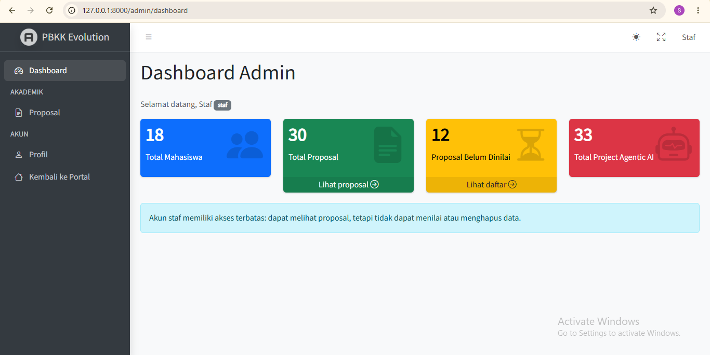

# PBKK Evolution

Royan Habibi Alfatih - 5025241115<br>


## Tugas 10: Admin Dashboard & Role-Based Access Control

Tugas Minggu 10 memindahkan seluruh hak akses ke **Spatie Laravel Permission** dan membangun panel admin berbasis **AdminLTE 4**. Halaman login tetap memakai Breeze; setelah login, admin/staf/dosen/asdos diarahkan ke `/admin/dashboard`, sedangkan mahasiswa tetap ke `/dashboard`. Kolom `users.role` dari Minggu 5 dihapus karena peran kini tersimpan di tabel otorisasi Spatie.

Panduan langkah demi langkah untuk mengulang perubahan ini secara manual tersedia di [docs/panduan-manual-minggu-10.md](./docs/panduan-manual-minggu-10.md).



### 1. Instalasi dan menjalankan proyek

```powershell
composer install
if (-not (Test-Path .env)) { Copy-Item .env.example .env }
php artisan key:generate
npm install
php artisan migrate:fresh --seed
npm run build
composer run dev
```

`migrate:fresh --seed` membuat tabel Spatie, peran & izin, akun demo, serta data dummy Faker. Paket yang ditambahkan: `spatie/laravel-permission` dan `jeroennoten/laravel-adminlte` ([composer.json, baris 16](./composer.json#L16)). Aset AdminLTE dipublikasikan ke `public/vendor/adminlte`; Bootstrap 5 dan Bootstrap Icons dimuat dari CDN.

### 2. Akun uji coba (Auto-Login Credentials)

Semua akun memakai password `password`. Pada `APP_ENV=local`, halaman Login menampilkan tombol quick login untuk setiap akun berikut.

| Akun | Email | Peran | Setelah login |
| --- | --- | --- | --- |
| Admin | `admin@example.com` | `admin` (akses penuh) | `/admin/dashboard` |
| Staf | `staf@example.com` | `staf` (akses terbatas) | `/admin/dashboard` |
| Dosen | `dosen@example.com` | `dosen` | `/admin/dashboard` |
| Asdos | `asdos@example.com` | `asdos` | `/admin/dashboard` |
| Andi / Budi | `andi@example.com` / `budi@example.com` | `mahasiswa` | `/dashboard` |

- [DemoUserSeeder.php, baris 13](./database/seeders/DemoUserSeeder.php#L13): akun demo dan `syncRoles()`.
- [DemoLoginController.php, baris 18](./app/Http/Controllers/Auth/DemoLoginController.php#L18): allowlist quick login (hanya environment `local`).
- [login.blade.php, baris 52](./resources/views/auth/login.blade.php#L52): tombol quick login Admin dan Staf.

### 3. Matriks peran dan izin (Spatie)

| Permission | admin | staf | dosen | asdos | mahasiswa |
| --- | :-: | :-: | :-: | :-: | :-: |
| `lihat-proposal` | ✓ | ✓ | ✓ | ✓ | |
| `kelola-nilai` | ✓ | | ✓ | ✓ | |
| `hapus-proposal` | ✓ | | | | |
| `ajukan-proposal` | | | | | ✓ |

Matriks didefinisikan sekali di seeder, lalu disinkronkan ke tabel `roles`, `permissions`, dan `role_has_permissions`. Cek hasilnya dengan `php artisan permission:show`.

- [RoleAndPermissionSeeder.php, baris 17](./database/seeders/RoleAndPermissionSeeder.php#L17): matriks peran → izin.
- [RoleAndPermissionSeeder.php, baris 25](./database/seeders/RoleAndPermissionSeeder.php#L25): `firstOrCreate` + `syncPermissions` + reset cache Spatie.
- [User.php, baris 20](./app/Models/User.php#L20): trait `HasRoles` pada model User.
- [2026_11_08_070000_drop_role_from_users_table.php, baris 19](./database/migrations/2026_11_08_070000_drop_role_from_users_table.php#L19): kolom `role` lama dihapus.
- [RegisteredUserController.php, baris 46](./app/Http/Controllers/Auth/RegisteredUserController.php#L46): user baru diberi peran `mahasiswa` oleh server.

```php
// database/seeders/RoleAndPermissionSeeder.php
public const MATRIX = [
    'admin' => ['lihat-proposal', 'kelola-nilai', 'hapus-proposal'],
    'staf' => ['lihat-proposal'],
    'dosen' => ['lihat-proposal', 'kelola-nilai'],
    'asdos' => ['lihat-proposal', 'kelola-nilai'],
    'mahasiswa' => ['ajukan-proposal'],
];
```

### 4. Penguncian rute dengan middleware Spatie

Alias `role`, `permission`, dan `role_or_permission` didaftarkan di `bootstrap/app.php`; alias ini menggantikan middleware kustom `cek.peran` dari Minggu 5. Grup `/admin` dikunci dengan `auth` + `role:admin|staf|dosen|asdos`, sehingga mahasiswa yang mengetik URL admin secara manual menerima HTTP 403.

- [bootstrap/app.php, baris 19](./bootstrap/app.php#L19): alias middleware Spatie.
- [routes/web.php, baris 72](./routes/web.php#L72): grup rute admin.
- [routes/web.php, baris 58](./routes/web.php#L58): grup rute mahasiswa `role:mahasiswa`.

```php
// routes/web.php
Route::prefix('admin')
    ->name('admin.')
    ->middleware(['auth', 'role:admin|staf|dosen|asdos'])
    ->group(function () {
        Route::get('/dashboard', AdminDashboardController::class)->name('dashboard');
        Route::get('/proposals', [AdminProposalController::class, 'index'])->name('proposals.index');
        Route::delete('/proposals/{proposal}', [AdminProposalController::class, 'destroy'])->name('proposals.destroy');
        // ...
    });
```

### 5. Pengaman Controller (server-side)

Di Laravel 11+ base `Controller` tidak lagi menyediakan `$this->middleware()` di constructor seperti pada slide. Penggantinya adalah interface `HasMiddleware` dengan method statis `middleware()`. Hasilnya sama: aksi `destroy` hanya dijalankan bila user memegang izin `hapus-proposal`. Request `DELETE` dari Postman oleh staf tetap ditolak 403 walaupun tombolnya tidak terlihat.

- [ProposalController.php, baris 13](./app/Http/Controllers/Admin/ProposalController.php#L13): `implements HasMiddleware`.
- [ProposalController.php, baris 18](./app/Http/Controllers/Admin/ProposalController.php#L18): middleware `permission:` per aksi.
- [GradeController.php, baris 15](./app/Http/Controllers/GradeController.php#L15): `Gate::authorize('kelola-nilai')`. Spatie mendaftarkan izinnya ke Gate, jadi kode Minggu 5 tetap berlaku tanpa `Gate::define` manual.

```php
// app/Http/Controllers/Admin/ProposalController.php
class ProposalController extends Controller implements HasMiddleware
{
    public static function middleware(): array
    {
        return [
            new Middleware('permission:lihat-proposal', only: ['index']),
            new Middleware('permission:hapus-proposal', only: ['destroy']),
        ];
    }
}
```

### 6. Proteksi elemen UI dengan Blade directive

Tombol **Hapus** hanya dirender untuk pemegang izin `hapus-proposal` (admin). Sidebar AdminLTE memakai kunci `'can'` sehingga menu **Input Nilai** tidak tampil untuk staf. Navigasi portal Breeze memakai `@role` dan `@hasanyrole`.

- [proposals/index.blade.php, baris 67](./resources/views/admin/proposals/index.blade.php#L67): `@can('hapus-proposal')`.
- [config/adminlte.php, baris 774](./config/adminlte.php#L774): menu sidebar dengan filter `'can'`.
- [navigation.blade.php, baris 18](./resources/views/layouts/navigation.blade.php#L18): `@role('mahasiswa')` dan `@hasanyrole(...)`.

```blade
{{-- resources/views/admin/proposals/index.blade.php --}}
@can('hapus-proposal')
    <form method="POST" action="{{ route('admin.proposals.destroy', $proposal) }}" class="d-inline"
        onsubmit="return confirm('Hapus proposal ini?');">
        @csrf
        @method('DELETE')
        <button type="submit" class="btn btn-sm btn-danger">Hapus</button>
    </form>
@endcan
```

### 7. Dashboard AdminLTE dan widget statistik

Seluruh halaman admin mewarisi `@extends('adminlte::page')`. Dashboard menampilkan empat widget `x-adminlte-small-box` dari kueri `count()`: total mahasiswa, total proposal, proposal belum dinilai, dan total project.

- [DashboardController.php, baris 16](./app/Http/Controllers/Admin/DashboardController.php#L16): kueri agregat.
- [dashboard.blade.php, baris 1](./resources/views/admin/dashboard.blade.php#L1): layout AdminLTE.
- [dashboard.blade.php, baris 17](./resources/views/admin/dashboard.blade.php#L17): widget small box.

```php
// app/Http/Controllers/Admin/DashboardController.php
return view('admin.dashboard', [
    'totalMahasiswa' => User::role('mahasiswa')->count(),
    'totalProposal' => Proposal::count(),
    'proposalBelumDinilai' => Proposal::whereNull('grade')->count(),
    'totalProject' => Project::count(),
]);
```

### 8. Redirect login berdasarkan peran

`User::homeRoute()` menentukan tujuan setelah login. Method ini dipakai oleh login Breeze dan quick login.

- [User.php, baris 55](./app/Models/User.php#L55): `homeRoute()`.
- [AuthenticatedSessionController.php, baris 32](./app/Http/Controllers/Auth/AuthenticatedSessionController.php#L32): redirect setelah login.

### 9. Challenge: pencarian `when()`, filter status, dan `withQueryString()`

Halaman **Proposal** di panel admin mencari judul **atau** nama mahasiswa (sub-query closure + `orWhereHas`) dan memfilter status nilai. Filter yang kosong diabaikan oleh `when()`. `withQueryString()` menjaga parameter `search` dan `status` di setiap link pagination. Kolom `title` diberi index agar pencarian lebih cepat.

- [ProposalController.php, baris 26](./app/Http/Controllers/Admin/ProposalController.php#L26): kueri `when()`.
- [ProposalController.php, baris 42](./app/Http/Controllers/Admin/ProposalController.php#L42): `paginate(10)->withQueryString()`.
- [proposals/index.blade.php, baris 16](./resources/views/admin/proposals/index.blade.php#L16): form pencarian GET.
- [2026_11_08_070001_add_title_index_to_proposals_table.php, baris 15](./database/migrations/2026_11_08_070001_add_title_index_to_proposals_table.php#L15): index kolom `title`.

```php
// app/Http/Controllers/Admin/ProposalController.php
$proposals = Proposal::query()
    ->with('user')
    ->when($request->input('search'), function ($query, string $search) {
        $query->where(function ($query) use ($search) {
            $query->where('title', 'like', "%{$search}%")
                ->orWhereHas('user', fn ($user) => $user->where('name', 'like', "%{$search}%"));
        });
    })
    ->when($status === 'dinilai', fn ($query) => $query->whereNotNull('grade'))
    ->when($status === 'belum', fn ($query) => $query->whereNull('grade'))
    ->latest()
    ->paginate(10)
    ->withQueryString();
```

Contoh URL: `/admin/proposals?search=Agent&status=belum&page=2`

### 10. Challenge: seeder Faker

`ProposalFactory` membuat judul, deskripsi, dan nilai acak (sekitar setengahnya belum dinilai). `DatabaseSeeder` melengkapi setiap mahasiswa Minggu 6 hingga memiliki dua proposal, sehingga tersedia 30 proposal untuk demo pagination. Seeder tetap aman dijalankan ulang.

- [ProposalFactory.php, baris 21](./database/factories/ProposalFactory.php#L21): atribut Faker.
- [DatabaseSeeder.php, baris 58](./database/seeders/DatabaseSeeder.php#L58): seeding proposal per mahasiswa.
- [UserFactory.php, baris 49](./database/factories/UserFactory.php#L49): state `withRole()` untuk tes.

### 11. Pengujian

[TestCase.php, baris 13](./tests/TestCase.php#L13) men-seed peran & izin untuk setiap tes yang memakai `RefreshDatabase`. [WeekTenTest.php](./tests/Feature/WeekTenTest.php) menguji:

- [baris 11](./tests/Feature/WeekTenTest.php#L11): guest diarahkan ke login dan mahasiswa mendapat 403;
- [baris 21](./tests/Feature/WeekTenTest.php#L21): angka widget dashboard;
- [baris 39](./tests/Feature/WeekTenTest.php#L39): tombol Hapus hanya untuk admin, dan `DELETE` oleh staf ditolak di server;
- [baris 69](./tests/Feature/WeekTenTest.php#L69): staf tidak bisa menilai;
- [baris 78](./tests/Feature/WeekTenTest.php#L78): pencarian judul/nama dan filter status;
- [baris 109](./tests/Feature/WeekTenTest.php#L109): link pagination mempertahankan filter;
- [baris 123](./tests/Feature/WeekTenTest.php#L123): redirect login per peran.

```powershell
php artisan test
php artisan test tests\Feature\WeekTenTest.php
vendor\bin\pint --test
```

### 12. Skenario demo (maksimal 3 menit)

1. Quick login **Admin**: dashboard menampilkan 4 widget, lalu buka **Proposal**, cari `Agent`, filter "Belum dinilai", dan pindah ke halaman 2 (filter tetap ada di URL).
2. Hapus satu proposal: pesan sukses muncul dan angka widget berkurang.
3. Logout, lalu quick login **Staf**: tombol Hapus dan menu Input Nilai tidak tampil. Membuka `/admin/grades` menghasilkan 403.
4. Logout, lalu quick login **Andi**: diarahkan ke `/dashboard`, dan membuka `/admin/dashboard` menghasilkan 403.

## Tugas 6: Database/Migrations

Tugas Minggu 6 memindahkan data project Agentic AI dari data statis ke database relasional. Tabel `users` bawaan Laravel menyimpan akun, sedangkan tabel `projects` menyimpan ide project dan foreign key pemiliknya. Implementasi tugas utama juga mencakup relasi Eloquent, perlindungan mass assignment pada model, dan seeder data contoh.

> Contoh kode berikut merujuk pada implementasi proyek. Tautan di setiap bagian membuka file sumber pada baris terkait.

### 1. Skema database dan migration

Migration bawaan Laravel membuat tabel `users`, termasuk kolom `name`, `email`, dan `password`; email diberi constraint unik. Migration `projects` membuat kolom judul, deskripsi opsional, tema agent dengan nilai default `Ollama`, API key opsional, dan foreign key `user_id` ke `users.id`. `cascadeOnDelete()` memastikan project milik user ikut dihapus ketika user tersebut dihapus.

- [0001_01_01_000000_create_users_table.php, baris 14](./database/migrations/0001_01_01_000000_create_users_table.php#L14): tabel akun dan kolom kredensial.
- [0001_01_01_000000_create_users_table.php, baris 17](./database/migrations/0001_01_01_000000_create_users_table.php#L17): constraint email unik.
- [2026_10_11_182002_create_projects_table.php, baris 18](./database/migrations/2026_10_11_182002_create_projects_table.php#L18): definisi tabel project.
- [2026_10_11_182002_create_projects_table.php, baris 21](./database/migrations/2026_10_11_182002_create_projects_table.php#L21): deskripsi nullable.
- [2026_10_11_182002_create_projects_table.php, baris 22](./database/migrations/2026_10_11_182002_create_projects_table.php#L22): tema agent default `Ollama`.
- [2026_10_11_182002_create_projects_table.php, baris 24](./database/migrations/2026_10_11_182002_create_projects_table.php#L24): foreign key pemilik dan cascade delete.

```php
// database/migrations/2026_10_11_182002_create_projects_table.php, baris 18–25
Schema::create('projects', function (Blueprint $table) {
    $table->id();
    $table->string('judul');
    $table->text('deskripsi')->nullable();
    $table->string('tema_agent')->default('Ollama');
    $table->text('api_key_secure')->nullable();
    $table->foreignId('user_id')->constrained('users')->cascadeOnDelete();
    $table->timestamps();
});
```

### 2. Model Eloquent, relasi, dan mass assignment

Relasi yang digunakan adalah **satu user memiliki banyak project** (`hasMany`), dan **setiap project dimiliki satu user** (`belongsTo`). Model `Project` memakai atribut `#[Fillable(...)]` untuk mengizinkan pengisian massal hanya pada atribut project yang tercantum. `user_id` tidak diambil dari data form; project dibuat melalui relasi user agar foreign key ditetapkan berdasarkan pemilik yang dipilih aplikasi.

- [User.php, baris 39](./app/Models/User.php#L39): relasi `projects()` bertipe `HasMany`.
- [Project.php, baris 9](./app/Models/Project.php#L9): whitelist atribut yang dapat diisi massal.
- [Project.php, baris 12](./app/Models/Project.php#L12): relasi `user()` bertipe `BelongsTo`.

```php
// app/Models/User.php, baris 39–42
public function projects(): HasMany
{
    return $this->hasMany(Project::class);
}

// app/Models/Project.php, baris 9–14
#[Fillable(['judul', 'deskripsi', 'tema_agent', 'api_key_secure'])]
class Project extends Model
{
    public function user(): BelongsTo {
        return $this->belongsTo(User::class);
    }
}
```

### 3. Factory dan seeder data

`ProjectFactory` memakai Faker untuk membuat judul, deskripsi, dan tema agent yang bervariasi. API key dummy bernilai `null`, sehingga seeding tidak memasukkan rahasia palsu ke database. Factory dipakai oleh `DatabaseSeeder` untuk menyiapkan 15 mahasiswa dengan dua project masing-masing.

- [ProjectFactory.php, baris 11](./database/factories/ProjectFactory.php#L11): model yang digunakan factory.
- [ProjectFactory.php, baris 20](./database/factories/ProjectFactory.php#L20): atribut dummy yang dihasilkan Faker.
- [DatabaseSeeder.php, baris 16](./database/seeders/DatabaseSeeder.php#L16): pemanggilan seeder akun demo Minggu 5.
- [DatabaseSeeder.php, baris 18](./database/seeders/DatabaseSeeder.php#L18): akun mahasiswa Wira dan project contoh.
- [DatabaseSeeder.php, baris 36](./database/seeders/DatabaseSeeder.php#L36): loop 15 mahasiswa.
- [DatabaseSeeder.php, baris 50](./database/seeders/DatabaseSeeder.php#L50): membuat project factory melalui relasi mahasiswa.
- [DatabaseSeeder.php, baris 55](./database/seeders/DatabaseSeeder.php#L55): akun dosen demo.
- [DatabaseSeeder.php, baris 76](./database/seeders/DatabaseSeeder.php#L76): project portofolio akun dosen.

```php
// database/seeders/DatabaseSeeder.php
$student = User::firstOrCreate(
    ['email' => sprintf('week6.mahasiswa.%02d@student.its.ac.id', $number)],
    [
        'name' => fake()->name(),
        'role' => 'mahasiswa',
        'password' => 'password',
    ]
);

$student->projects()->saveMany(
    Project::factory()->count($projectsToCreate)->make()
);
```

Nama mahasiswa dan isi project dibuat Faker. Email mahasiswa memakai nomor yang tetap agar seeder dapat dijalankan ulang tanpa menambah duplikat; bila seeder dijalankan kembali, seeder hanya membuat jumlah project yang masih kurang dari dua. Data contoh Wira dari tugas utama tetap disediakan.

`DatabaseSeeder` juga memanggil `DemoUserSeeder` agar empat akun demo Minggu 5 tetap tersedia. Seeder membuat akun demo tambahan `dosenpbkk@its.ac.id` dengan role `dosen` dan dua project portofolio siap presentasi. Password lokal akun demo adalah `password`.

Untuk demo cepat, pada environment `local`, halaman Login menyediakan tombol **Minggu 6: Mahasiswa 01**. Tombol ini mengautentikasi akun `week6.mahasiswa.01@student.its.ac.id` (password akun seed: `password`) sehingga project milik akun tersebut dapat langsung dilihat di dashboard. Quick login tidak tersedia di luar environment `local`.

### 4. Menjalankan dan memverifikasi database

Setelah konfigurasi database lokal siap, jalankan migration dan seeder:

```powershell
php artisan migrate
php artisan db:seed
php artisan migrate:status
php artisan db:table users
php artisan db:table projects
```

Perintah `migrate:status` memperlihatkan migration yang sudah dijalankan; `db:table` menampilkan kolom, index, dan foreign key. Seeder aman dijalankan lebih dari sekali: user ditentukan berdasarkan email, project sampel berdasarkan judul dan pemilik, dan setiap mahasiswa challenge dilengkapi hingga memiliki dua project.

Untuk memverifikasi jumlah user mahasiswa challenge beserta jumlah project per user, buka Tinker:

```powershell
php artisan tinker
```

Lalu jalankan:

```php
$students = \App\Models\User::where('email', 'like', 'week6.mahasiswa.%@student.its.ac.id')->orderBy('email')->get();
$students->count();
$students->map(fn ($student) => [$student->email, $student->projects()->count()]);

$lecturer = \App\Models\User::where('email', 'dosenpbkk@its.ac.id')->first();
$lecturer?->projects()->get(['judul', 'tema_agent', 'user_id']);
```

Hasil yang diharapkan: 15 mahasiswa challenge ditemukan dan masing-masing memiliki dua project; akun demo dosen memiliki dua project portofolio. Keluar dari Tinker dengan `exit`.

### 5. Menampilkan project milik user aktif di dashboard

Dashboard mengambil daftar project melalui relasi milik user yang sedang login, mengurutkannya dari yang terbaru, lalu menampilkan judul, deskripsi, dan tema agent. Karena query berawal dari `$request->user()->projects()`, hasilnya hanya berisi project milik akun aktif.

- [DashboardController.php, baris 14](./app/Http/Controllers/DashboardController.php#L14): query project terbaru melalui relasi user terautentikasi.
- [dashboard.blade.php, baris 17](./resources/views/dashboard.blade.php#L17): daftar portofolio pada dashboard.
- [WeekSixChallengeTest.php, baris 49](./tests/Feature/WeekSixChallengeTest.php#L49): uji bahwa project user lain tidak tampil.

```php
// app/Http/Controllers/DashboardController.php, baris 14
'projects' => $request->user()->projects()->latest()->get(),
```

### 6. Uji challenge

Feature test memastikan 15 mahasiswa memiliki masing-masing dua project, akun dosen demo memiliki portofolio, seeder dapat dijalankan ulang tanpa duplikasi, dan dashboard tidak membocorkan project milik akun lain.

- [WeekSixChallengeTest.php, baris 10](./tests/Feature/WeekSixChallengeTest.php#L10): uji data seeder dan jumlah project.
- [WeekSixChallengeTest.php, baris 37](./tests/Feature/WeekSixChallengeTest.php#L37): uji seeder berulang.
- [WeekSixChallengeTest.php, baris 49](./tests/Feature/WeekSixChallengeTest.php#L49): uji pembatasan project berdasarkan user aktif.

Jalankan test dengan:

```powershell
php artisan test tests\Feature\WeekSixChallengeTest.php
```

## Tugas 5: Secure Academic Portal

> **Catatan Minggu 10:** kolom `users.role`, middleware `cek.peran`, dan `Gate::define('kelola-nilai')` yang dijelaskan di bagian ini sudah digantikan oleh Spatie Laravel Permission. Lihat [Tugas 10](#tugas-10-admin-dashboard--role-based-access-control). Penjelasan di bawah dipertahankan sebagai dokumentasi Minggu 5; tautan baris kode menunjuk versi file saat ini.

Tugas Minggu 5 mengembangkan sandbox menjadi portal akademik dengan autentikasi Breeze dan otorisasi berdasarkan role. Fitur wajib yang diterapkan mencakup register/login, migration role, middleware khusus untuk route admin, Gate pengelolaan nilai, Policy untuk kepemilikan proposal, serta proteksi aksi pada Blade. Fitur pendukungnya meliputi dashboard, profil akun, peninjauan proposal, dan pengisian nilai.

> Contoh kode berikut berasal dari implementasi proyek. Judul setiap bagian menautkan file sumber beserta nomor baris agar pembaca dapat melihat kode lengkap dan konteksnya.

### 1. Breeze: registrasi, login, dan logout

Breeze Blade menyediakan halaman dan route register, login, serta logout. Route autentikasi dipisahkan dari route aplikasi dan dimuat dari `routes/web.php`.

- [routes/auth.php, baris 14](./routes/auth.php#L14): register/login hanya tersedia untuk guest.
- [RegisteredUserController.php, baris 31](./app/Http/Controllers/Auth/RegisteredUserController.php#L31): validasi dan pembuatan akun.
- [AuthenticatedSessionController.php, baris 25](./app/Http/Controllers/Auth/AuthenticatedSessionController.php#L25): login dan regenerasi session.
- [AuthenticatedSessionController.php, baris 37](./app/Http/Controllers/Auth/AuthenticatedSessionController.php#L37): logout, invalidasi session, regenerasi token CSRF.
- [login.blade.php, baris 5](./resources/views/auth/login.blade.php#L5): form login POST dengan CSRF.
- [routes/auth.php, baris 25](./routes/auth.php#L25): endpoint permintaan/reset password; scaffold juga mendaftarkan route verifikasi email dan konfirmasi password. Portal ini belum mewajibkan verifikasi email untuk mengakses fitur.

Setelah Breeze memvalidasi kredensial, session ID dirotasi sebelum pengguna diarahkan ke dashboard:

```php
// app/Http/Controllers/Auth/AuthenticatedSessionController.php, baris 25–31
public function store(LoginRequest $request): RedirectResponse
{
    $request->authenticate();
    $request->session()->regenerate();

    return redirect()->intended(route('dashboard', absolute: false));
}
```

Saat logout, session lama dan token CSRF juga diperbarui:

```php
// app/Http/Controllers/Auth/AuthenticatedSessionController.php, baris 37–47
Auth::guard('web')->logout();
$request->session()->invalidate();
$request->session()->regenerateToken();

return redirect('/');
```

Scaffold halaman portal Breeze menggunakan layout portal terpisah, sementara halaman sandbox publik tetap menggunakan layout `layouts.app`. Ini menjaga tampilan lama sambil memberi dashboard autentikasi navigasi akun responsif. Lihat [AppLayout.php, baris 15](./app/View/Components/AppLayout.php#L15), [portal.blade.php, baris 9](./resources/views/layouts/portal.blade.php#L9), dan [layouts/app.blade.php, baris 309](./resources/views/layouts/app.blade.php#L309).

### 2. Role, migration, dan registrasi mahasiswa

Role ditambahkan ke tabel `users` sebagai kolom string dengan default `mahasiswa`. Akun yang dibuat melalui register memperoleh role itu di server; pengguna tidak dapat mengirim role dosen/asdos melalui form untuk meningkatkan hak akses.

- [2026_10_11_000001_add_role_to_users_table.php, baris 15](./database/migrations/2026_10_11_000001_add_role_to_users_table.php#L15): migration penambahan kolom role.
- [User.php, baris 14](./app/Models/User.php#L14): atribut model serta proteksi mass assignment.
- [RegisteredUserController.php, baris 31](./app/Http/Controllers/Auth/RegisteredUserController.php#L31): validasi input register.

```php
// app/Http/Controllers/Auth/RegisteredUserController.php, baris 38–46
$user = User::create([
    'name' => $request->name,
    'email' => $request->email,
    'password' => Hash::make($request->password),
    'role' => 'mahasiswa',
]);
```

Factory juga menetapkan role mahasiswa sebagai nilai awal untuk pengguna uji: [UserFactory.php, baris 30](./database/factories/UserFactory.php#L30).

### 3. Akun demo dan seeder

`DemoUserSeeder` menyiapkan empat akun presentasi. Seeder memakai `updateOrCreate`, sehingga dapat dijalankan lagi tanpa menduplikasi akun berdasarkan email yang sama. `DatabaseSeeder` memanggil seeder demo.

- [DemoUserSeeder.php, baris 8](./database/seeders/DemoUserSeeder.php#L8): daftar nama, email, dan role.
- [DemoUserSeeder.php, baris 18](./database/seeders/DemoUserSeeder.php#L18): penyimpanan akun dan password demo.
- [DatabaseSeeder.php, baris 13](./database/seeders/DatabaseSeeder.php#L13): pemanggilan seeder demo.

| Nama | Email untuk login | Role |
| --- | --- | --- |
| Andi | `andi@example.com` | `mahasiswa` |
| Budi | `budi@example.com` | `mahasiswa` |
| Asdos | `asdos@example.com` | `asdos` |
| Dosen | `dosen@example.com` | `dosen` |

Password bersama akun demo adalah `password`. Kredensial ini hanya untuk pengembangan/presentasi lokal, bukan untuk produksi. Form login Breeze menerima email, jadi gunakan email pada tabel di atas, bukan nama tampilan.

### 4. Custom Middleware `cek.peran` dan route admin

Middleware `CheckRole` memeriksa apakah role pengguna yang sedang login termasuk dalam daftar role yang diizinkan. Role di luar daftar ditolak dengan HTTP 403.

- [CheckRole.php, baris 11](./app/Http/Middleware/CheckRole.php#L11): implementasi pemeriksaan role.
- [bootstrap/app.php, baris 16](./bootstrap/app.php#L16): alias middleware `cek.peran`.
- [routes/web.php, baris 63](./routes/web.php#L63): grup route admin untuk dosen/asdos.
- [AcademicPortalTest.php, baris 61](./tests/Feature/AcademicPortalTest.php#L61): pengujian akses berdasarkan role.

```php
// bootstrap/app.php, baris 16–18
$middleware->alias([
    'cek.peran' => CheckRole::class,
]);

// routes/web.php, baris 63–69
Route::prefix('admin')
    ->name('admin.')
    ->middleware(['auth', 'cek.peran:dosen,asdos'])
    ->group(function () {
        Route::get('/', AdminController::class)->name('index');
        Route::get('/grades', [GradeController::class, 'index'])->name('grades.index');
        Route::patch('/grades/{proposal}', [GradeController::class, 'update'])->name('grades.update');
    });
```

Middleware `auth` mengarahkan guest ke login. Setelah login, mahasiswa tetap ditolak dari route admin, sedangkan dosen dan asdos boleh masuk. Route proposal mahasiswa secara terpisah memakai `auth` dan `cek.peran:mahasiswa` di [routes/web.php, baris 52](./routes/web.php#L52).

### 5. Global Gate `kelola-nilai`

Gate global didefinisikan di `AppServiceProvider`: hanya role `dosen` dan `asdos` yang boleh mengelola nilai. Controller memeriksa Gate di server sebelum menampilkan form atau menyimpan nilai.

- [AppServiceProvider.php, baris 24](./app/Providers/AppServiceProvider.php#L24): definisi Gate.
- [GradeController.php, baris 15](./app/Http/Controllers/GradeController.php#L15): proteksi halaman nilai.
- [GradeController.php, baris 24](./app/Http/Controllers/GradeController.php#L24): proteksi aksi menyimpan nilai.
- [grades.blade.php, baris 17](./resources/views/admin/grades.blade.php#L17): form dibungkus directive `@can`.

```php
// app/Providers/AppServiceProvider.php, baris 24
Gate::define('kelola-nilai', fn (User $user): bool => in_array($user->role, ['dosen', 'asdos'], true));

// app/Http/Controllers/GradeController.php, baris 24–32
Gate::authorize('kelola-nilai');
$validated = $request->validate([
    'grade' => ['required', 'numeric', 'between:0,100'],
]);
$proposal->update($validated);
```

`@can` menyembunyikan aksi dari UI yang tidak berhak; pemeriksaan `Gate::authorize()` di server tetap menjadi kontrol akses yang utama.

### 6. Proposal, relasi pemilik, dan `ProposalPolicy`

Proposal menyimpan pemilik, judul, deskripsi opsional, dan nilai opsional. Relasi `User::proposals()` memungkinkan dashboard mengambil proposal milik akun yang sedang login. Saat membuat proposal, controller menyimpannya melalui relasi pengguna tersebut, bukan mempercayai `user_id` dari form.

- [2026_10_11_000002_create_proposals_table.php, baris 12](./database/migrations/2026_10_11_000002_create_proposals_table.php#L12): skema dan foreign key proposal.
- [User.php, baris 34](./app/Models/User.php#L34): relasi `hasMany`.
- [ProposalController.php, baris 18](./app/Http/Controllers/ProposalController.php#L18): validasi dan penyimpanan oleh mahasiswa aktif.
- [DashboardController.php, baris 10](./app/Http/Controllers/DashboardController.php#L10): query proposal milik user aktif.
- [ProposalPolicy.php, baris 10](./app/Policies/ProposalPolicy.php#L10): aturan Policy pengubahan judul.
- [ProposalController.php, baris 30](./app/Http/Controllers/ProposalController.php#L30): otorisasi server sebelum edit/update.
- [AcademicPortalTest.php, baris 78](./tests/Feature/AcademicPortalTest.php#L78): uji kepemilikan dan penolakan mahasiswa lain.

Hanya mahasiswa pemilik proposal yang dapat mengubah judul:

```php
// app/Policies/ProposalPolicy.php, baris 10–13
public function update(User $user, Proposal $proposal): bool
{
    return $user->role === 'mahasiswa' && $user->id === $proposal->user_id;
}
```

Dashboard saat ini merupakan tempat mahasiswa melihat proposal sendiri dan pesan keadaan kosong. Tombol edit di UI juga dilindungi `@can('update', $proposal)`:

```blade
{{-- resources/views/dashboard.blade.php, baris 36–42 --}}
@can('update', $proposal)
    <a class="mt-3 inline-block text-sm text-indigo-700 underline" href="{{ route('proposals.edit', $proposal) }}">
        Ubah judul
    </a>
@endcan
```

### 7. Dashboard, peninjauan proposal, dan pengisian nilai

Dashboard menampilkan proposal milik mahasiswa yang login. Dosen/asdos dapat membuka tinjauan seluruh proposal dan halaman input nilai. Nilai divalidasi sebagai angka dari 0 sampai 100.

- [DashboardController.php, baris 10](./app/Http/Controllers/DashboardController.php#L10): mengambil data dashboard dari relasi user aktif.
- [dashboard.blade.php, baris 16](./resources/views/dashboard.blade.php#L16): tampilan dan daftar proposal mahasiswa.
- [AdminController.php, baris 10](./app/Http/Controllers/AdminController.php#L10): daftar proposal untuk admin.
- [GradeController.php, baris 22](./app/Http/Controllers/GradeController.php#L22): validasi dan update nilai.
- [navigation.blade.php, baris 18](./resources/views/layouts/navigation.blade.php#L18): navigasi portal berdasarkan role/Gate.
- [grades.blade.php, baris 17](./resources/views/admin/grades.blade.php#L17): input nilai yang dibatasi `@can`.

Route/controller melindungi aksi pada server. Navigasi dan `@can` menyesuaikan kontrol yang terlihat sesuai izin pengguna.

### 8. Profile pengguna

Breeze menambahkan halaman pengelolaan profil terautentikasi untuk memperbarui nama/email, memperbarui password, dan menghapus akun. Email divalidasi unik; jika email berubah, status verifikasinya direset. Penghapusan akun meminta password saat ini dan mengakhiri session.

- [routes/web.php, baris 72](./routes/web.php#L72): route profile berada di dalam middleware `auth`.
- [ProfileController.php, baris 17](./app/Http/Controllers/ProfileController.php#L17): menampilkan profil.
- [ProfileUpdateRequest.php, baris 17](./app/Http/Requests/ProfileUpdateRequest.php#L17): validasi nama dan email unik.
- [ProfileController.php, baris 27](./app/Http/Controllers/ProfileController.php#L27): simpan pembaruan profil.
- [ProfileController.php, baris 43](./app/Http/Controllers/ProfileController.php#L43): hapus akun dan invalidasi session.
- [edit.blade.php, baris 1](./resources/views/profile/edit.blade.php#L1): halaman dengan form profil, password, dan penghapusan akun.

Role tidak dapat diubah dari form profil.

### 9. Navigasi dan Local Login Demo

Navigasi portal menampilkan tautan yang sesuai dengan role: mahasiswa mendapat akses membuat proposal, dosen/asdos mendapat tautan tinjau proposal, dan `@can` mengatur visibilitas input nilai. Dropdown akun menyediakan profile dan logout.

**Local Login Demo Minggu 4 bukan autentikasi.** Kartu Guest/Andi/Budi hanya mengarahkan ke homepage dengan query parameter `user`; kartu tersebut tidak membuat akun, session, atau hak akses role. Jika sesi Breeze sudah aktif, homepage menampilkan nama akun yang login alih-alih nilai query.

- [navigation.blade.php, baris 18](./resources/views/layouts/navigation.blade.php#L18): tautan portal berdasar role dan Gate.
- [AuthenticatedSessionController.php, baris 37](./app/Http/Controllers/Auth/AuthenticatedSessionController.php#L37): proses logout.
- [local-login.blade.php, baris 111](./resources/views/local-login.blade.php#L111): kartu simulasi query.
- [PageController.php, baris 9](./app/Http/Controllers/PageController.php#L9): nama akun terautentikasi mengesampingkan query.
- [AcademicPortalTest.php, baris 125](./tests/Feature/AcademicPortalTest.php#L125): pengujian bahwa demo query tidak mengautentikasi.

### 10. Setup dan menjalankan demo

Setelah PHP, Composer, Node.js, dan npm tersedia, siapkan aplikasi lokal:

```powershell
composer install
if (-not (Test-Path .env)) { Copy-Item .env.example .env }
php artisan key:generate
npm install
php artisan migrate --seed
npm run build
```

`php artisan migrate --seed` membuat skema dan akun demo di database yang dikonfigurasi oleh `.env`. Gunakan email dan password dari bagian [Akun demo dan seeder](#3-akun-demo-dan-seeder). Untuk menjalankan layanan development, gunakan `composer run dev`.

> Jangan gunakan password demo `password` di server publik. Pastikan `.env` tidak dimasukkan ke Git.

### 11. Tantangan ekstra: throttle proposal dan quick login lokal

Kedua tantangan opsional Minggu 5 sudah diterapkan.

#### Maksimal tiga pengiriman proposal per menit

Named limiter `proposal-submissions` membatasi mahasiswa yang sudah login menjadi tiga request POST ke route `proposals.store` per menit. Kuota dipisahkan berdasarkan ID pengguna; request keempat dalam window tersebut menerima HTTP 429 dan tidak membuat proposal baru. Request yang gagal validasi juga dihitung karena limiter melindungi route sebelum controller memproses form.

- [AppServiceProvider.php, baris 29](./app/Providers/AppServiceProvider.php#L29): definisi named rate limiter dengan kuota per ID mahasiswa.
- [routes/web.php, baris 61](./routes/web.php#L61): middleware `throttle:proposal-submissions` pada route submit proposal.
- [WeeklyChallengesTest.php, baris 10](./tests/Feature/WeeklyChallengesTest.php#L10): uji batas tiga submission.
- [WeeklyChallengesTest.php, baris 25](./tests/Feature/WeeklyChallengesTest.php#L25): uji kuota terpisah antar mahasiswa.

#### Quick login untuk akun demo (local saja)

Pada halaman login Breeze, environment `local` menampilkan empat tombol: Andi dan Budi (mahasiswa), Asdos, dan Dosen. Tombol mengirim form POST ber-CSRF ke route `/login/as/{account}`; handler hanya mengenali slug tetap tersebut, mencari email demo terkait, melakukan login melalui guard `web`, lalu meregenerasi session sebelum mengarahkan pengguna ke dashboard.

- [login.blade.php, baris 48](./resources/views/auth/login.blade.php#L48): empat tombol quick-login hanya ditampilkan pada environment local.
- [web.php, baris 53](./routes/web.php#L53): route quick-login dengan middleware `guest`.
- [DemoLoginController.php, baris 15](./app/Http/Controllers/Auth/DemoLoginController.php#L15): guard environment; allowlist akun dan session regeneration berlanjut pada method yang sama.
- [WeeklyChallengesTest.php, baris 42](./tests/Feature/WeeklyChallengesTest.php#L42): visibilitas tombol berbeda antara `local` dan `testing`.
- [WeeklyChallengesTest.php, baris 57](./tests/Feature/WeeklyChallengesTest.php#L57): autentikasi setiap akun demo dan verifikasi rotasi session.
- [WeeklyChallengesTest.php, baris 79](./tests/Feature/WeeklyChallengesTest.php#L79): route menolak environment non-local dan slug tidak dikenal.

Pastikan akun sudah tersedia dengan `php artisan migrate --seed`. Route quick-login mengembalikan 404 di luar environment `local`; tombolnya juga tidak dirender. Jangan jalankan aplikasi dengan `APP_ENV=local` pada server yang dapat diakses publik, karena mode local memang mengaktifkan jalur login tanpa password untuk akun demo. Quick login ini berbeda dari **Local Login Demo Minggu 4**, yang hanya mengubah query parameter dan tidak mengautentikasi.

### 12. Pengujian

Pengujian portal utama berada di [AcademicPortalTest.php, baris 1](./tests/Feature/AcademicPortalTest.php#L1). Uji khusus tantangan ada di [WeeklyChallengesTest.php, baris 1](./tests/Feature/WeeklyChallengesTest.php#L1), meliputi batas submission per mahasiswa, isolasi kuota, quick-login akun demo, rotasi session, dan pembatasan environment.

```bash
php artisan test
php artisan test tests/Feature/WeeklyChallengesTest.php
npm run build
```

## Tugas 4: Required

### Master Layout

`layouts/app.blade.php` menjadi kerangka bersama untuk halaman. Layout menyediakan judul dinamis dan memuat CSS melalui Vite.

```blade
{{-- resources/views/layouts/app.blade.php at line: 6 --}}
<title>@yield('title', 'PBKK Evolution')</title>
@fonts
@vite(['resources/css/app.css'])
```

Layout yang sama menyediakan navbar, area konten, dan footer.

```blade
{{-- resources/views/layouts/app.blade.php at line: 225 --}}
<nav class="navbar" aria-label="Main navigation">
    {{-- Tautan navigasi --}}
</nav>

<main>
    @yield('content')
</main>

<footer class="footer">
    <p>&copy; {{date('Y')}} PBKK Evolution</p>
    <p>Made by: Royan Habibi Alfatih</p>
    <a href="{{route('home')}}">Home</a>
</footer>
```

Halaman menggunakan layout tersebut dan mengisi judul serta kontennya melalui section Blade.

```blade
{{-- resources/views/home.blade.php at line: 1 --}}
@extends('layouts.app')

@section('title', $pageTitle)

@section('content')
    <style>
        /* Gaya halaman beranda */
    </style>

    {{-- Konten beranda --}}
@endsection
```

### Routing dengan `PageController`

Route beranda (`/`), profil mahasiswa (`/profil-mahasiswa`), dan ide agen (`/ide-agent`) didefinisikan di `routes/web.php` dan menggunakan method pada `PageController`.

```php
// routes/web.php at line: 7
Route::get('/', [PageController::class, 'index'])
    ->name('home');
```

```php
// routes/web.php at line: 30
Route::get('/profil-mahasiswa', [PageController::class, 'profilMahasiswa'])
    ->name('profilMahasiswa');
Route::get('/ide-agent', [PageController::class, 'ideAgent'])
    ->name('ideAgent');
```

Kedua route tersebut mengarahkan pengguna ke halaman tujuan masing-masing.

```php
// app/Http/Controllers/PageController.php at line: 153
public function profilMahasiswa() {
    return redirect()->route('mahasiswa.show', ['nrp' => '5025241115']);
}

public function ideAgent() {
    return redirect()->route('agent', ['tema' => 'gmail']);
}
```

### Reusable Blade Components & Slots

`<x-info-card>` menampilkan kartu informasi dengan judul dan isi dari slot.

```blade
{{-- resources/views/components/info-card.blade.php at line: 1 --}}
@props(['title'])

<article {{ $attributes->merge(['class' => 'info-card']) }}>
    <h2>{{ $title }}</h2>
    {{ $slot }}
</article>
```

Contoh penggunaannya menampilkan nama dan NRP pada baris terpisah.

```blade
{{-- resources/views/mahasiswa.blade.php at line: 72 --}}
<x-info-card title="Profil Mahasiswa">
    <p>Nama: {{ $nama }}</p>
    <p>NRP: {{ $nrp }}</p>
    <p>Hobi: {{ $hobi }}</p>
    <p>IPK: {{ $ipk }} / 4.00</p>
</x-info-card>
```

`<x-status-banner>` menampilkan pesan status, misalnya setelah masukan berhasil dikirim.

```blade
{{-- resources/views/components/status-banner.blade.php at line: 1 --}}
@props(['message'])

<p {{ $attributes->class(['status-banner']) }} role="status" aria-live="polite">
    {{ $message }}
</p>
```

### Vite Asset Bundling

Vite memproses aset CSS dan JavaScript aplikasi. Plugin Laravel Vite juga dikonfigurasi untuk menyediakan font Instrument Sans dalam bobot 400, 500, dan 600. Directive `@fonts` pada layout memuat font yang dikonfigurasi, sedangkan `@vite` memuat CSS hasil build. Layout menetapkan Instrument Sans pada elemen `body`, sehingga font digunakan secara konsisten oleh halaman dan komponen yang mewarisi gaya tersebut.

```js
// vite.config.js at line: 8
laravel({
    input: ['resources/css/app.css', 'resources/js/app.js'],
    refresh: true,
    fonts: [
        bunny('Instrument Sans', {
            weights: [400, 500, 600],
        }),
    ],
}),
```

Layout utama memuat stylesheet aplikasi dan font, lalu menerapkan Instrument Sans ke seluruh konten halaman.

```blade
{{-- resources/views/layouts/app.blade.php at line: 7 --}}
@fonts
@vite(['resources/css/app.css'])
```

Font diterapkan pada `body` di layout agar menjadi font bawaan di seluruh halaman.

```css
/* resources/views/layouts/app.blade.php at line: 18 */
body {
    margin: 0;
    font-family: 'Instrument Sans', sans-serif;
}
```

## Tugas 4: Challenge

### Light/Dark Mode Parameter URL

Beranda membaca `mode` dari query string. Jika nilainya `dark`, halaman menggunakan kelas mode gelap; jika tidak, halaman menggunakan mode terang. Tombol pada navbar mengubah parameter URL tersebut.

Contoh URL: `/?mode=dark`

```php
// app/Http/Controllers/PageController.php at line: 16
$mode = $request->query('mode') === 'dark' ? 'dark' : 'light';

return view('home', [
    'pageTitle' => 'PBKK Evolution',
    'user' => $user,
    'mode' => $mode,
]);
```

Kelas mode pada halaman beranda mengikuti nilai tersebut.

```blade
{{-- resources/views/home.blade.php at line: 261 --}}
<div @class(['home-page', 'home-page--dark' => $mode === 'dark'])>
    <x-welcome-toast :user="$user" />
    {{-- Konten beranda --}}
</div>
```

Fitur ini hanya diimplementasikan di Beranda `/` dan Project Idea `/dashboard/project-idea`.

### Notifikasi Welcome Parameter URL

Parameter `user` pada URL menentukan nama yang disapa di beranda. Nama yang dikenal ditampilkan sebagai nama pengguna; jika parameter tidak cocok, aplikasi menyapa sebagai `Guest`. Komponen `<x-welcome-toast>` menampilkan notifikasi yang dapat ditutup dan menghilang otomatis.

Contoh URL: `/?user=Andi`

Parameter ini hanya simulasi tampilan untuk pengunjung yang belum login. Jika sesi Breeze aktif, nama akun yang sedang login akan ditampilkan dan mengesampingkan nilai query.

```php
// app/Http/Controllers/PageController.php at line: 10
$requestedUser = $request->query('user');
$user = match (is_string($requestedUser) ? strtolower($requestedUser) : null) {
    'andi' => 'Andi',
    'budi' => 'Budi',
    default => 'Guest',
};
```

```blade
{{-- resources/views/home.blade.php at line: 262 --}}
<x-welcome-toast :user="$user" />
```

```blade
{{-- resources/views/components/welcome-toast.blade.php at line: 1 --}}
@props(['user' => 'Guest'])

<div {{ $attributes->class(['welcome-toast']) }} role="status" aria-live="polite" data-welcome-toast>
    <span>Selamat datang, {{ $user }}!</span>
    <button class="welcome-toast__close" type="button" aria-label="Tutup notifikasi">&times;</button>
</div>
```
